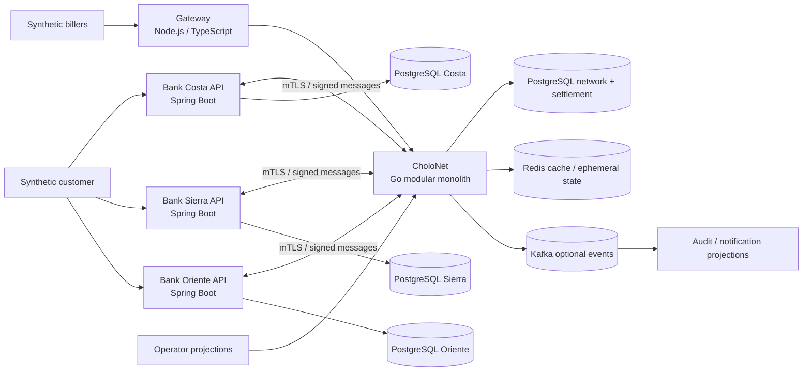

# C4 containers

Each PostgreSQL database is a distinct service and volume. Redis is never authoritative for balances, ledger entries, final settlement state, or the only copy of a key. Kafka is not a source of truth.
