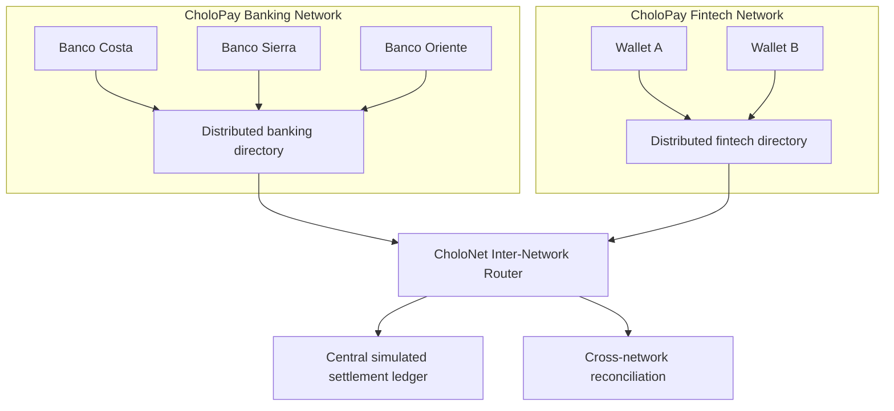

# Arquitectura interredes de CholoPay



## Contrato de rutas

`INTRA_NETWORK` stays within the participant domain. `INTER_NETWORK` crosses domains and requires CholoNet coordination. A missing, suspended, or ambiguous participant is rejected before funds are reserved. A route decision never means `SETTLED`; only the central ledger commit can establish that state.

Every route message includes `schema_version`, `message_type`, `source_network_id`, `destination_network_id`, `source_participant_id`, `destination_participant_id`, `correlation_id`, `causation_id`, `idempotency_key`, and UTC timestamps.

## Directorio CholoKey simulado

Cada red es propietaria de su espacio de nombres del directorio. Una consulta está delimitada por `network_id`, `key_type` y `key_value`; el mismo valor de clave puede existir en directorios de redes distintas sin cruzar límites de propiedad. El resolvedor interno es:

```text
POST /internal/v1/directory/resolve
```

Una respuesta exitosa emite una envoltura de evidencia versionada `DIRECTORY_KEY_RESOLVED`. Las claves inexistentes o suspendidas se rechazan, y la restricción de unicidad de la base de datos impide dos interpretaciones activas de la misma clave dentro de una red. Esta es una simulación determinista, no una conexión con un directorio nacional real.

## Envoltura de mensajes interredes

La coordinación entre dominios se persiste mediante:

```text
POST /internal/v1/inter-network/messages
```

La envoltura contiene los identificadores de red de origen y destino, el esquema y tipo de mensaje, los identificadores de correlación/causación, una clave de idempotencia, un hash SHA-256 del payload, el payload JSON y la hora de creación UTC. El receptor valida que ambas redes estén activas y sean distintas. Repetir una envoltura idéntica devuelve el registro aceptado sin un segundo efecto; reutilizar la clave de idempotencia con un payload o ruta diferentes se rechaza. Este es un límite de coordinación de entrega al menos una vez, no un resultado de liquidación ni un mensaje ISO 20022.

## Recepción de extremo a extremo

El punto de entrada interno compuesto es:

```text
POST /internal/v1/inter-network/transfers
```

Resuelve la propiedad del participante antes de persistir la instrucción de transferencia. Para `INTRA_NETWORK`, solo se crea la instrucción. Para `INTER_NETWORK`, también persiste un mensaje `TRANSFER_REQUESTED` usando el ID de transferencia como ID estable del mensaje. Los replays devuelven la instrucción y el mensaje existentes; ninguna ruta liquida fondos. El endpoint de liquidación central sigue siendo el único lugar que puede producir `SETTLED`.
