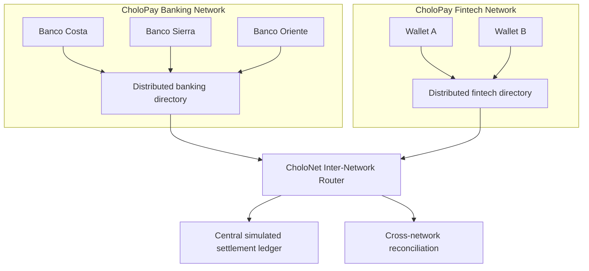

# CholoPay Inter-Network architecture



## Route contract

`INTRA_NETWORK` stays within the participant domain. `INTER_NETWORK` crosses domains and requires CholoNet coordination. A missing, suspended, or ambiguous participant is rejected before funds are reserved. A route decision never means `SETTLED`; only the central ledger commit can establish that state.

Every route message includes `schema_version`, `message_type`, `source_network_id`, `destination_network_id`, `source_participant_id`, `destination_participant_id`, `correlation_id`, `causation_id`, `idempotency_key`, and UTC timestamps.

## Simulated CholoKey directory

Each network owns its directory namespace. A lookup is scoped by `network_id`, `key_type`, and `key_value`; the same key value may exist in different network directories without crossing ownership boundaries. The internal resolver is:

```text
POST /internal/v1/directory/resolve
```

A successful response emits a versioned `DIRECTORY_KEY_RESOLVED` evidence envelope. Missing or suspended keys are rejected, and the database uniqueness constraint prevents two active interpretations of the same key inside one network. This is a deterministic simulation, not a connection to a real national directory.

## Inter-network message envelope

Cross-domain coordination is persisted through:

```text
POST /internal/v1/inter-network/messages
```

The envelope carries sender and destination network IDs, schema and message type, correlation/causation IDs, an idempotency key, a SHA-256 payload hash, JSON payload, and UTC creation time. The receiver validates that both networks are active and distinct. Repeating an identical envelope returns the accepted record without a second effect; reusing the idempotency key with a different payload or route is rejected. This is an at-least-once coordination boundary, not a settlement result and not an ISO 20022 message.

## End-to-end intake

The composed internal entrypoint is:

```text
POST /internal/v1/inter-network/transfers
```

It resolves participant ownership before persisting the transfer instruction. For `INTRA_NETWORK`, only the instruction is created. For `INTER_NETWORK`, it also persists one `TRANSFER_REQUESTED` message using the transfer ID as the stable message ID. Replays return the existing instruction and message; neither path settles funds. The central settlement endpoint remains the only place that can produce `SETTLED`.
