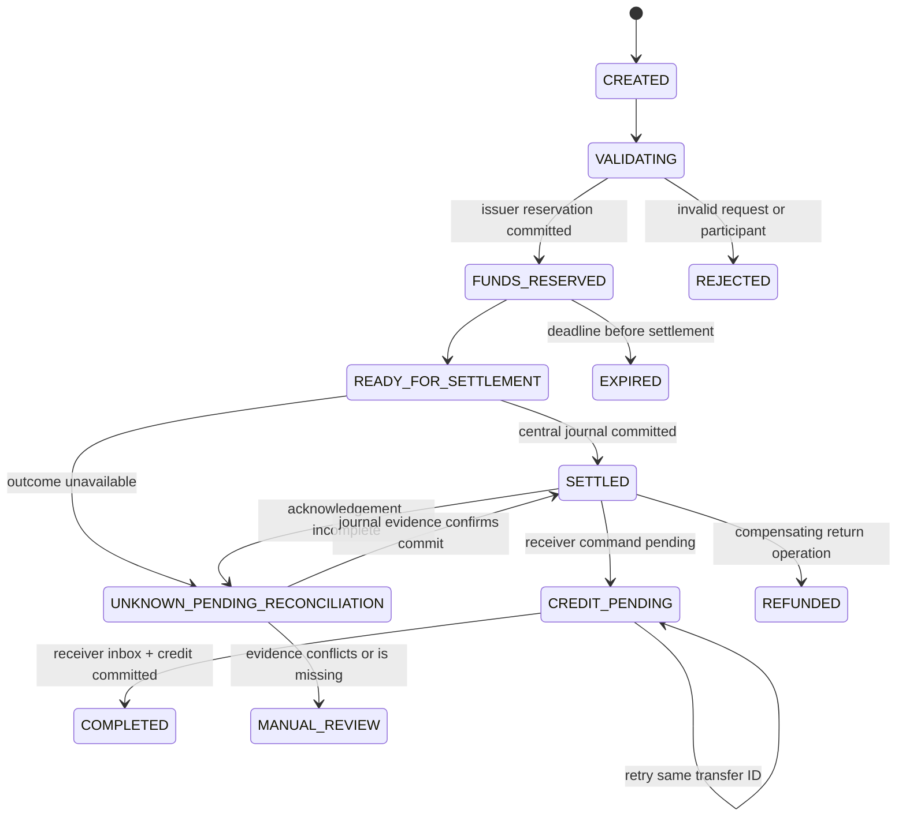

# Interbank transfer state contract

## State ownership

| State | Authority | Meaning |
|---|---|---|
| `CREATED`, `VALIDATING` | Network instruction store | Request accepted for validation; no financial effect |
| `FUNDS_RESERVED` | Issuer bank plus instruction store | Issuer has a durable local reservation |
| `READY_FOR_SETTLEMENT` | Network | All preconditions passed; no central journal yet |
| `SETTLED` | Network settlement ledger | One balanced central journal is committed |
| `CREDIT_PENDING` | Network and receiver inbox | Receiver credit command is durable but not applied |
| `COMPLETED` | Receiver bank and network projection | Receiver credit and issuer finalization are confirmed |
| `UNKNOWN_PENDING_RECONCILIATION` | Reconciliation subsystem | Outcome cannot safely be inferred; no new transfer may be created |
| `REFUNDED` | Derived view | A separate compensating return settled |

Every transition carries `schema_version`, `transfer_id`, `correlation_id`, `causation_id`, UTC timestamp, and actor/service identity. Invalid transitions are rejected without changing stored state.
