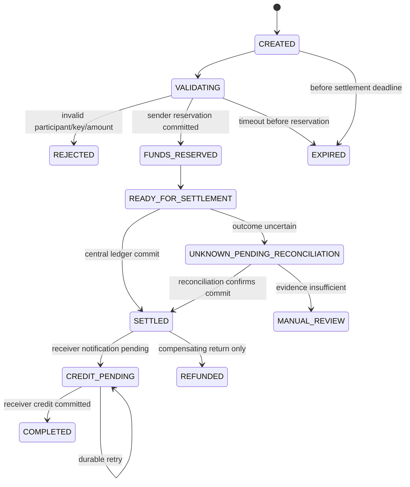

# Transfer protocol and state machine

The protocol separates instruction acceptance, reservation, central settlement, and receiver credit. A successful HTTP response is not evidence of settlement.

## Required guarantees

- Bank reservation and bank ledger effects use local ACID transactions and unique idempotency constraints.
- The network atomically records one settlement operation and balanced settlement entries.
- Receiver credit is an at-least-once message with inbox idempotency; exactly-once financial effect is achieved by persistent identifiers and reconciliation, not transport promises.
- A timeout after possible settlement yields `UNKNOWN_PENDING_RECONCILIATION`; clients must not retry with a new business identifier.
- Published entries are immutable. Returns are new compensating operations.

## ADR questions deferred to Phase 2

The exact recovery protocol after issuer failure and liquidity/funding policy require explicit ADR approval before interbank behavior is implemented.
