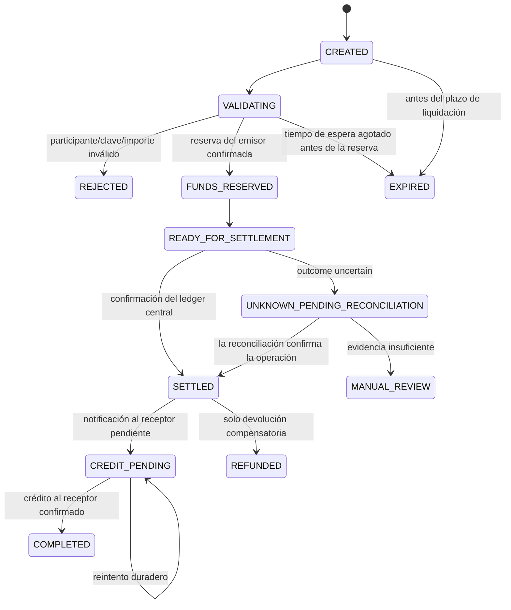

# Protocolo de transferencias y máquina de estados

El protocolo separa la aceptación de la instrucción, la reserva, la liquidación central y el abono al receptor. Una respuesta HTTP exitosa no es evidencia de liquidación.

## Garantías requeridas

- La reserva bancaria y los efectos sobre el ledger bancario usan transacciones ACID locales y restricciones de idempotencia únicas.
- La red registra atómicamente una operación de liquidación y asientos de liquidación equilibrados.
- El abono al receptor es un mensaje entregado al menos una vez con idempotencia en el inbox; el efecto financiero exactamente una vez se logra mediante identificadores persistentes y conciliación, no mediante promesas del transporte.
- Un timeout después de una posible liquidación produce `UNKNOWN_PENDING_RECONCILIATION`; los clientes no deben reintentar con un identificador de negocio nuevo.
- Published entries are immutable. Returns are new compensating operations.

## Preguntas ADR diferidas a la fase 2

El protocolo exacto de recuperación tras un fallo del emisor y la política de liquidez/fondeo requieren aprobación explícita mediante ADR antes de implementar el comportamiento interbancario.
