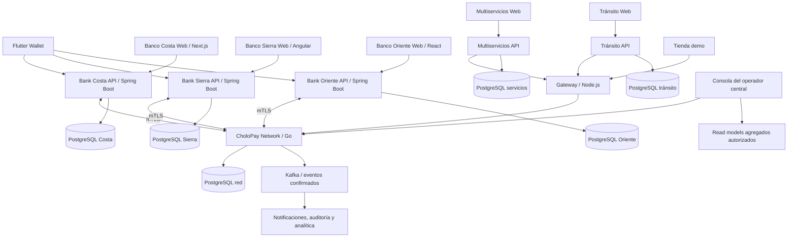

# CholoPay Network — Especificación maestra de ingeniería

> **Versión:** 1.1 · **Fecha:** 2026-11-09 · **Estado:** propuesta para implementación · **Idioma:** español  
> **Naturaleza:** proyecto educativo y de portafolio. Dinero, bancos, cuentas y liquidaciones **100 % simulados**. No es un servicio financiero autorizado, no utiliza la infraestructura real de Pix y no está afiliado al Banco Central del Ecuador ni al Banco Central de Brasil.

## 0. Instrucciones obligatorias para la IA implementadora

Actúa como arquitecto de software senior, ingeniero de sistemas distribuidos y desarrollador principal. Este archivo es la **fuente de verdad inicial**. Implementa de forma incremental, con código ejecutable, pruebas, documentación y criterios de aceptación. **No generes todo el ecosistema de una sola vez.** Antes de cada fase: (1) identifica decisiones pendientes, (2) produce un plan pequeño, (3) implementa, (4) ejecuta pruebas, (5) actualiza documentación y (6) registra resultados. No inventes integraciones bancarias ni métricas de rendimiento. No uses dinero real. No incluyas secretos en repositorios. Ante una ambigüedad financiera, prioriza integridad contable y solicita aprobación antes de cambiar invariantes.

**Restricción transversal obligatoria:** todos los componentes necesarios para desarrollar, ejecutar, probar, observar y desplegar el ecosistema deben ser **software libre y de código abierto (FOSS)**, sin licencias de pago, servicios SaaS obligatorios, funciones enterprise cerradas ni límites artificiales de usuarios/transacciones. Consultar la sección 22 antes de incorporar dependencias. El código propio se publicará bajo una licencia libre explícita.

**Primera tarea concreta:** crear el repositorio `cholopay-architecture` con ADRs iniciales, diagramas C4 en Mermaid, modelo de amenazas, máquina de estados de transferencias, contratos OpenAPI preliminares y backlog de la fase 0; después preparar `cholopay-infra` con Docker Compose y un smoke test. No empezar por interfaces gráficas.

## 1. Visión, posicionamiento y nombre

**Nombre elegido por el creador:** CholoPay Network (verificar marcas, dominios y conflictos antes de uso público). **Identidad:** el término «Cholo» expresa la identificación cultural personal del autor; evitar atribuir representación oficial a comunidades, instituciones o pueblos. No usar iconografía cultural ajena sin autorización. **CholoKey:** identificador aleatorio de pago. **CholoNet:** red interoperable simulada. **CholoClearing:** subsistema de liquidación. **CholoLab:** laboratorio de carga y resiliencia.

**Propuesta de valor:** demostrar un ecosistema de pagos instantáneos interoperables inspirado en Pix, con tres instituciones financieras independientes, billetera móvil, comercio electrónico, API pública, directorio de claves, motor central de liquidación, supervisión y pruebas de rendimiento reproducibles.

**Objetivos de portafolio:** backend Go, Java/Spring Boot, Node.js/TypeScript; frontend React/Next.js y Angular; móvil Flutter; PostgreSQL; Kafka; seguridad; sistemas distribuidos; CI/CD; observabilidad; modelado financiero; documentación y pruebas de carga.

**No objetivos:** procesar dinero real, conectarse a SPI/DICT reales, simular cumplimiento regulatorio como certificación, copiar interfaces o marcas registradas, almacenar datos personales reales, operar como banco.

## 2. Referencias conceptuales y límites de analogía

- **Pix (Brasil):** directorio de claves, participantes, pagos instantáneos, liquidación individual, QR, devoluciones y disponibilidad continua. No se implementará su protocolo oficial ni se afirmará interoperabilidad real.
- **Mercado Libre:** caso publicado de adopción de Go para servicios de alto tráfico. No extrapolar sus resultados a CholoPay ni afirmar que todo Mercado Pago usa Go.
- **PayPal:** arquitectura históricamente documentada con React, Node.js y servicios Java; no afirmar que sea su stack completo actual.
- **Nubank:** inspiración en ingeniería de plataformas y Flutter; no copiar arquitectura interna.

Fuentes de referencia para contrastar antes de implementar: [Banco Central de Brasil — Pix](https://www.bcb.gov.br/estabilidadefinanceira/pix-sobre), [Banco Central de Brasil — normas Pix](https://www.bcb.gov.br/estabilidadefinanceira/pix-normas), [Go — Mercado Libre](https://go.dev/solutions/mercadolibre), [PayPal Engineering](https://medium.com/paypal-tech/scaling-graphql-at-paypal-b5b5ac098810). Estas fuentes son referencias, no especificaciones exhaustivas de la implementación.

## 3. Actores y límites de confianza

| Actor | Función | Puede hacer | No puede hacer |
|---|---|---|---|
| Persona usuaria | Titular de cuenta en banco simulado | Abrir cuenta en un banco, registrar CholoKey, transferir, pagar QR | Acceder al ledger de otros usuarios |
| Banco Costa (simulado) | Participante A | Autenticar clientes, mantener cuentas/ledger propios, enviar instrucciones | Escribir en BD del Banco B o de la red |
| Banco Sierra (simulado) | Participante B | Igual que A | Igual que A |
| Banco Oriente (simulado) | Participante C | Igual que A, con datos, cuentas, certificados y despliegue propios | Acceder directamente a las bases de los otros participantes |
| Empresa multiservicios (simulada) | Facturador de luz, agua, internet y telefonía móvil | Emitir facturas ficticias, consultar cobros propios y registrar su cumplimiento | Debitar cuentas de clientes o liquidar sin la red |
| Autoridad de Tránsito (simulada) | Facturador de matrículas y multas vehiculares | Emitir obligaciones ficticias, consultar pagos y emitir constancias simuladas | Acceder a cuentas privadas o actuar como autoridad real |
| Operador de red (rol «autoridad simulada») | Administrar CholoNet | Admitir/suspender participantes, monitorear, configurar fondos ficticios en operaciones auditadas | Modificar balances sin asientos o alterar operaciones liquidadas |
| Comercio | Vender en tienda | Crear intentos de pago, recibir webhooks, reembolsar según política | Acceder a cuentas bancarias de clientes |
| Desarrollador externo | Integrar API sandbox | Crear claves, probar pagos y webhooks | Crear dinero o liquidar directamente |
| Auditor | Revisar operaciones | Consultar evidencia y reportes autorizados | Mutar movimientos históricos |

**Registro correcto inspirado en Pix:** el usuario se registra en **una institución participante**, que verifica su identidad **ficticia** y administra su cuenta. La institución solicita a la red registrar una CholoKey vinculada a la cuenta. La red central administra el directorio y la liquidación; no es un banco minorista. El panel del operador central registra **instituciones**, no cuentas bancarias minoristas. Una consola educativa de autoalta de usuarios puede redirigir al banco elegido, pero no atribuir la apertura de cuentas al operador central.

## 4. Productos / repositorios

| Repositorio | Tecnología | Responsabilidad |
|---|---|---|
| `cholopay-architecture` | Markdown, Mermaid, OpenAPI | Diseño, ADR, threat model, RFC, runbooks |
| `cholopay-infra` | Docker Engine + Compose plugin en Linux, OpenTofu opcional, Kubernetes posterior | Entorno local, despliegues, observabilidad, certificados de prueba |
| `cholopay-network` | **Go** | Registro de participantes, directorio CholoKey, routing, validación, coordinación de liquidación, estado de instrucciones |
| `cholopay-bank-core` | **Java LTS + Spring Boot** | Aplicación bancaria parametrizable, cuentas, ledger, reservas, abonos, autenticación y API por participante |
| `cholopay-bank-costa-web` | **Next.js + React + TypeScript** | Portal del banco A |
| `cholopay-bank-sierra-web` | **Angular + TypeScript** | Portal del banco B |
| `cholopay-bank-oriente-web` | **React + TypeScript (Vite)** | Portal del banco C |
| `cholopay-utilities` | Java + Spring Boot, PostgreSQL | Empresa ficticia unificada de electricidad, agua, internet y telefonía móvil: contratos, facturación y cobranza |
| `cholopay-utilities-web` | React + TypeScript | Portal de la empresa multiservicios para usuarios y operadores |
| `cholopay-transit` | Java + Spring Boot, PostgreSQL | Autoridad de tránsito ficticia: matrículas, multas, obligaciones y constancias |
| `cholopay-transit-web` | Angular + TypeScript | Portal ciudadano y administrativo de tránsito simulado |
| `cholopay-wallet` | **Flutter + Dart** | Billetera, QR, transferencias, movimientos, push simuladas |
| `cholopay-gateway` | **Node.js + TypeScript** | BFF/API developer, auth de clientes externos, checkout y webhooks; no escribe ledger |
| `cholopay-operator-console` | React + TypeScript | Supervisión central, participantes, liquidación, incidentes, métricas |
| `cholopay-commerce` | Next.js + TypeScript | Tienda de demostración consumidora de la API pública |
| `cholopay-sdk` | TypeScript primero; Java/Python después | SDKs públicos, ejemplos y pruebas contractuales |
| `cholopay-load-lab` | k6 OSS y/o Gatling OSS (verificar edición/licencia); Go para generadores especializados | Escenarios de carga, fault injection, benchmarks comparativos |

**Decisión de despliegue:** Banco A, Banco B y Banco C usan el mismo código `bank-core` pero **instancias, credenciales, bases de datos y claves independientes**. No duplicar lógica bancaria para simular independencia. La red no accede a sus tablas internas.

## 5. Arquitectura de alto nivel



**Separación de datos:** cada uno de los tres bancos tiene su propia BD y ledger. La red mantiene su ledger de liquidación, directorio y estados. Kafka no es fuente de verdad de saldos. Redis 8+ (seleccionado bajo AGPL-3.0) se usa para caché, límites de frecuencia y datos efímeros; nunca para el ledger ni los saldos oficiales. El gateway nunca modifica balances.

**Despliegue inicial:** monolito modular Go para la red + monolito modular Java para cada banco + BFF opcional en fase posterior. Extraer microservicios solo después de medir necesidad. No introducir Kubernetes hasta que el entorno Compose y las pruebas estén estabilizados.

## 6. Dominio financiero e invariantes innegociables

### 6.1 Modelo contable

- **Partida doble** en ledger bancario y ledger de liquidación: cada asiento tiene débitos/créditos equilibrados en la misma moneda.
- Los movimientos publicados son **inmutables**; correcciones y devoluciones crean movimientos compensatorios.
- Importes **enteros en centavos** (`BIGINT` con validación de overflow) para USD; nunca `float`/`double` para dinero.
- Moneda inicial USD; no FX en MVP.
- El saldo disponible es una proyección validada del ledger y las reservas; nunca la única evidencia del dinero.
- Cada transacción de negocio tiene `transaction_id`, `idempotency_key` en el ámbito adecuado, `correlation_id`, `causation_id`, `created_at`, `settled_at` y trazas de auditoría.
- Toda modificación financiera local ocurre dentro de transacciones ACID con restricciones, índices únicos y control de concurrencia explícito.
- **Invariante A:** la suma de débitos y créditos por asiento y moneda es cero bajo la convención contable elegida.
- **Invariante B:** ninguna cuenta restringida queda con saldo disponible negativo.
- **Invariante C:** una misma instrucción de negocio no produce dos liquidaciones.
- **Invariante D:** los saldos agregados de liquidación de las instituciones permanecen conservados en transferencias interbancarias (sin emisiones o ajustes administrativos explícitos y auditados).
- **Invariante E:** un pago liquidado no se borra ni se «desliquida» por timeout; devoluciones son operaciones nuevas.

### 6.2 Entidades mínimas

`Participant`, `ParticipantCredential`, `SettlementAccount`, `SettlementEntry`, `SettlementBatch` (solo para conciliación, no para liquidación diferida), `Customer`, `BankAccount`, `LedgerAccount`, `Journal`, `JournalEntry`, `BalanceReservation`, `CholoKey`, `KeyClaim`, `TransferInstruction`, `TransferStateHistory`, `PaymentIntent`, `Merchant`, `ApiCredential`, `WebhookEndpoint`, `WebhookDelivery`, `Refund`, `AuditEvent`, `OutboxEvent`, `InboxEvent`, `ReconciliationRun`, `ReconciliationDifference`, `RiskRule`, `RiskDecision`.

### 6.3 Transferencias internas vs. interbancarias

- **Intra-banco:** débito y crédito en una única transacción del banco, con ledger equilibrado e idempotencia.
- **Interbancaria:** varias bases de datos, sin transacción ACID global. Definir protocolo explícito de preparación/reserva, liquidación central definitiva y confirmación/abono del receptor. Los estados intermedios son visibles y recuperables.
- **Pre-liquidación:** reservar fondos del emisor y validar destinatario, participantes y fondos de liquidación.
- **Liquidación:** registrar atómicamente en la red el débito/crédito entre cuentas de liquidación y el identificador único de operación.
- **Post-liquidación:** entregar notificación duradera al receptor para abono idempotente; el emisor finaliza su débito/reserva. Reintentos hasta confirmar o escalar a conciliación. No revertir una liquidación confirmada por ausencia de respuesta.
- **Garantías:** transporte al menos una vez; efectos financieros **exactamente una vez por identificador** mediante idempotencia, constraints y reconciliación, no mediante una promesa de entrega exactamente una vez en toda la red.
- **Disponibilidad:** si no se puede establecer con certeza el estado de liquidación, no repetir la operación con nuevo ID ni informar «fallida» sin reconciliar; usar `UNKNOWN_PENDING_RECONCILIATION`.

### 6.4 Estados propuestos

`CREATED -> VALIDATING -> FUNDS_RESERVED -> READY_FOR_SETTLEMENT -> SETTLED -> CREDIT_PENDING -> COMPLETED`.

Estados alternativos: `REJECTED` (antes de liquidar), `EXPIRED` (antes de liquidar), `UNKNOWN_PENDING_RECONCILIATION`, `MANUAL_REVIEW`. `REFUNDED` es una vista derivada de devolución compensatoria, no una eliminación de la transferencia original.

**ADR obligatorio:** documentar quién autoriza la reserva, cómo se evita el doble gasto, qué ocurre si falla el emisor después de liquidar, cómo se garantiza el abono del receptor, y qué significa `COMPLETED`. Probar cada ventana de caída.

## 7. Directorio CholoKey, QR y experiencia Pix-like

- Claves: alias aleatorio `CholoKey` (recomendado para compartir), correo o teléfono **ficticios** opcionales; la unicidad y privacidad deben definirse por tipo y ámbito.
- El registro se inicia desde el banco participante, con autenticación del titular, verificación de posesión simulada y consentimiento.
- El directorio central resuelve clave -> participante + referencia opaca de cuenta; no revela información personal innecesaria.
- Permitir crear, consultar, suspender, eliminar y portar una clave entre bancos simulados mediante flujo autorizado, auditado y sin carreras.
- QR estático y dinámico; incluir versión de payload, identificador del comercio, referencia, importe opcional/obligatorio, expiración y firma/autenticidad según perfil. **Formato propio** documentado: no llamarlo QR Pix compatible.
- El pagador debe confirmar destinatario e importe antes de autorizar.
- Evitar enumeración masiva del directorio: rate limits, respuestas minimizadas, auditoría y protección de privacidad.
- Usuario puede tener cuentas en varios bancos; una CholoKey activa apunta a una cuenta destinataria en un instante dado.

## 8. Aplicaciones y funcionalidades

### 8.1 Banco Costa, Banco Sierra y Banco Oriente

Alta ficticia de usuarios; login/MFA de prueba; cuentas; movimientos; saldos disponible/contable; registro de CholoKeys; transferencias internas e interbancarias; pagos QR; historial con estados; comprobantes; devoluciones; alertas; panel operativo del banco; conciliación de sus asientos con la red. Frontends diferentes, APIs bancarias compatibles. Cada portal web DEBE permitir iniciar, autorizar y consultar transferencias internas e interbancarias, pagos QR/código, pagos de servicios, pagos vehiculares, descarga de comprobantes y gestión de CholoKeys. Los tres portales y Flutter deben reflejar el mismo estado persistido mediante las APIs del banco, sin lógica financiera en el cliente.

### 8.2 Wallet Flutter

Selección de institución; login; listado de cuentas; balance; envío por CholoKey; escaneo/generación QR; confirmación fuerte de operaciones; historial; notificaciones; tratamiento de conectividad intermitente; consulta y pago de facturas de servicios básicos, matrículas y multas; elección explícita de cuenta de origen en el banco autenticado. La app y los portales web sincronizan el estado desde las APIs y eventos; nunca desde bases de datos de otros bancos. Nunca registrar automáticamente una nueva transferencia por reintento de UI: conservar clave de idempotencia. No almacenar secretos bancarios en texto plano.

### 8.3 Operador central (simulador de banco central)

Alta y suspensión de participantes; emisión **ficticia** y auditable de saldos iniciales de liquidación; visualización de cuentas de liquidación, TPS, latencias, tasas de rechazo, colas, reconciliación, salud de servicios, claves registradas agregadas, incidentes, trazas y reportes; supervisión de facturadores, facturas agregadas, matrículas y multas ficticias, pagos, devoluciones, conciliación y excepciones, mediante proyecciones autorizadas de solo lectura. No será el portal de pago de los ciudadanos ni el emisor de sus obligaciones. Roles `NETWORK_ADMIN`, `NETWORK_OPERATOR`, `AUDITOR`, `READ_ONLY`. Separación de funciones para ajustes críticos y auditoría append-only.

### 8.4 Gateway de pagos, comercio y developer portal

Sandbox con claves de API de alcance limitado; creación de `payment_intents`; checkout; QR dinámico; confirmación de pago; webhooks HMAC firmados con timestamp y protección de replay; reintentos con DLQ; historial de entregas; reembolsos; SDK TypeScript; portal de documentación OpenAPI; tienda de prueba con catálogo, carrito, órdenes, inventario y webhook idempotente. El comercio **nunca** confía en la redirección del navegador como prueba definitiva de pago.

## 9. Contratos API preliminares (versionar desde v1)

**Red central (Go):**
- `POST /v1/participants` (solo operador)
- `GET /v1/participants/{id}`
- `POST /v1/keys` (participante autenticado)
- `GET /v1/keys/resolve?key=...` (participante autorizado; minimización)
- `POST /v1/transfers` (participante autenticado, `Idempotency-Key`)
- `GET /v1/transfers/{id}`
- `POST /v1/transfers/{id}/returns` (devolución compensatoria autorizada)
- `GET /v1/settlement/accounts/{participantId}` (autorización por ámbito)
- `GET /v1/reconciliation/runs/{id}`

**Banco (Java):**
- `POST /v1/customers` (datos ficticios)
- `GET /v1/accounts`
- `GET /v1/accounts/{id}/transactions`
- `POST /v1/transfers/internal`
- `POST /v1/transfers/interbank`
- `POST /v1/keys`
- `POST /v1/payment-authorizations`

**Gateway público (Node.js):**
- `POST /v1/payment-intents`
- `GET /v1/payment-intents/{id}`
- `POST /v1/payment-intents/{id}/confirm`
- `POST /v1/refunds`
- `POST /v1/webhook-endpoints`

**Estándares de contrato:** OpenAPI 3.1; UUID/ULID; importes `amount_minor`; `currency=USD`; errores Problem Details RFC 9457; paginación cursor; timestamps UTC RFC 3339; idempotency key + hash de payload + TTL definido; respuesta 409 para reutilización de clave con payload diferente; 429 con `Retry-After`; eventos versionados; contratos generados y validados en CI.

Ejemplo de intención de pago:

```json
{
  "amount_minor": 2500,
  "currency": "USD",
  "merchant_order_id": "ORDER-1001",
  "description": "Compra simulada"
}
```

## 10. Seguridad y privacidad

- OIDC/OAuth 2.1 donde corresponda, PKCE para clientes públicos, sesiones seguras y rotación de refresh tokens; JWT con validación de firma, `iss`, `aud`, `exp`, `nbf` y scopes.
- mTLS entre instituciones y red, certificados de laboratorio con rotación; identidades de servicio y mínimo privilegio.
- MFA para usuarios, reautenticación para operaciones sensibles; RBAC/ABAC y autorización por recurso/tenant.
- API keys de comercios almacenadas como hashes, reveladas una sola vez, rotación y revocación.
- TLS en tránsito, cifrado de discos/backups, secretos mediante variables seguras o gestor de secretos; nunca logs de tokens.
- Protección OWASP ASVS/API Top 10, CSRF cuando corresponda, CORS estricto, rate limiting, antifraude básico, validación de entradas, control de enumeración de claves.
- Datos exclusivamente sintéticos; generador de identidades ficticias; no usar cédulas, teléfonos o cuentas reales.
- Auditoría resistente a manipulación con controles de acceso y hash encadenado opcional; no afirmar inmutabilidad criptográfica absoluta sin pruebas.
- Threat model STRIDE: doble gasto, replay, sustitución de destinatario, suplantación de participante, webhook falsificado, fuga de claves, insider fraud, denegación de servicio, eventos duplicados, reloj desincronizado.
- No afirmar cumplimiento PCI DSS, ISO 27001 o regulación ecuatoriana sin auditoría formal. Evitar datos de tarjetas reales.

## 11. Concurrencia, fiabilidad y mensajería

- PostgreSQL: transacciones cortas, `SELECT ... FOR UPDATE` o actualización condicional para saldos/reservas, restricciones únicas y orden consistente de locks.
- Outbox transaccional por servicio y consumidores inbox/idempotentes; Kafka para notificaciones, analítica y propagación de eventos **después** del commit.
- Mensajes con `event_id`, `aggregate_id`, `version`, `occurred_at`, `trace_id`, esquema versionado; orden por clave de partición cuando se requiera.
- Reintentos exponenciales con jitter y límites; DLQ + replay administrativo idempotente.
- Timeouts y circuit breakers con estados `UNKNOWN` cuando el resultado financiero sea incierto.
- Recuperación tras reinicio, particiones de red, duplicados, reordenamiento de eventos y caída de una institución.
- Backups y restore testados; migraciones de esquema reversibles cuando sea posible; RPO/RTO definidos para cada entorno (no inventar objetivos de producción).

## 12. Go en producción: adoptar aprendizajes documentados de Mercado Libre, sin duplicar trabajo

### 12.1 Evidencia pública y atribución correcta

**Fuente primaria:** caso de estudio oficial del proyecto Go, *MercadoLibre Grows with Go*, publicado el **10 de noviembre de 2019**: https://go.dev/solutions/mercadolibre

El estudio describe **Mercado Libre (ecosistema que incluye Mercado Pago como consumidor de APIs compartidas)**; **NO demuestra una migración integral del backend de Mercado Pago a Go**, ni publica el código interno completo de sus servicios.

Hallazgos **históricos, específicos de los servicios documentados**, no metas ni garantías para CholoPay:

- La plataforma API histórica utilizaba **Groovy/Grails** y fue adoptando **Go** por problemas de escalabilidad, tiempos de pruebas, builds y despliegues.
- Un servicio pasó de **32 servidores a 4**; además, los servidores pasaron de **4 núcleos a 2** según el caso descrito. No extrapolar estas cifras.
- El artículo cita una API capaz de manejar **70.000 solicitudes por máquina con ~20 MB de RAM**; la fuente no define ese valor como TPS sostenido del sistema de pagos ni como carga transaccional de ledger.
- Reporta **builds 3× más rápidos** y suite de pruebas **24× más rápida** (de **90 s a 3 s**) en el contexto del equipo estudiado.
- Describe APIs de usuarios con **8–10 millones de solicitudes por minuto** y latencias menores a **10 ms**; no son transferencias interbancarias liquidadas ni cifras que CholoPay deba prometer.
- Documenta el uso de **primitivas de concurrencia de Go** para multiplexar identificadores de servicios y una plataforma interna de despliegue **Fury** con plantillas y automatización.

### 12.2 Decisiones concretas para CholoPay

**No implementar dos versiones de producción del mismo router. No recrear la migración Groovy/Grails → Go.** El estudio publicado ya aporta razones para escoger Go; nuestro trabajo será **aplicar sus patrones a un dominio nuevo y validar nuestro propio sistema**.

1. Construir `cholopay-network` **directamente en Go**, con módulos bien definidos para registro de participantes, directorio CholoKey, enrutamiento, validación, estado de instrucciones y coordinación de liquidación.
2. Mantener `cholopay-bank-core` en **Java LTS + Spring Boot** para cuentas y ledger de cada banco; no migrar ese núcleo a Go ni duplicarlo por deporte.
3. Usar `net/http` o un router Go liviano, `context.Context`, límites de concurrencia, timeouts, pools de conexiones, cancelación y goroutines controladas; **nunca goroutines sin límite**.
4. Priorizar rutas de datos eficientes, contratos compactos, conexiones persistentes y pocos saltos entre servicios; no sacrificar auditoría o consistencia para reducir latencia.
5. Estandarizar plantillas, builds reproducibles, imágenes multi-stage, CI/CD y observabilidad, inspirados en el enfoque de plataforma Fury **sin copiar su implementación propietaria**.
6. Instrumentar `pprof`, métricas de heap/RSS, CPU, goroutines, pausas GC, latencia p50/p95/p99, throughput liquidado y errores. Perfilar antes de optimizar.
7. Evaluar **un benchmark de microcomponentes adopción de Go basada en evidencia solo como extensión opcional** si una hipótesis concreta lo justifica; no es requisito de aceptación y no debe retrasar la red.
8. Escribir un caso de estudio propio `docs/case-studies/why-go.md`: evidencia ajena citada → decisiones tomadas → métricas medidas en CholoPay → limitaciones. **Nunca presentar métricas de Mercado Libre como resultados propios**.

**Afirmación válida para portafolio:** «Implementé una red simulada de pagos instantáneos en Go aplicando prácticas de concurrencia y eficiencia documentadas por Mercado Libre; validé su comportamiento con pruebas de carga y resiliencia reproducibles».

## 13. Rendimiento y laboratorio de hasta un millón de transferencias

### 13.1 Distinciones obligatorias

- `N operaciones completadas` ≠ `N TPS`.
- Medir `TPS` end-to-end **liquidado y conciliado**, no solo requests HTTP aceptadas.
- Distinguir tráfico sintético de directorio, lectura de saldos, pagos internos, interbancarios y webhooks.
- Escalar progresivamente; un millón de transferencias es **objetivo experimental**, no garantía.

### 13.2 Escenarios escalonados

| Nivel | Volumen total objetivo | Condiciones |
|---|---:|---|
| Smoke | 100 | Exactitud de saldos y estados |
| Baseline | 1.000 | Medición de latencias |
| Carga | 10.000 | Concurrencia parametrizada |
| Stress | 100.000 | Saturación controlada, perfiles |
| Gran volumen | 1.000.000 | Dataset y recursos adecuados, ejecución prolongada |

Cada nivel se ejecuta con tasas de llegada configurables, por ejemplo 10/100/500/1000 operaciones por segundo **como objetivos de carga, no capacidades prometidas**. El generador de carga debe estar separado de los servicios bajo prueba para no falsear los resultados. Medir también backpressure y duración de vaciado de colas.

### 13.3 Matriz de pruebas

- Transferencias exitosas entre A y B; simultáneas en sentidos opuestos.
- 1.000 intentos concurrentes sobre la misma cuenta con saldo limitado: **sin doble gasto**.
- 10.000 solicitudes con la misma clave de idempotencia: **un solo efecto financiero**.
- Reintentos por timeout después de liquidar: **sin segunda liquidación**.
- Caída del receptor antes/después de liquidación: **recuperación y abono eventual**.
- Caída del emisor tras reserva y tras liquidación: **sin pérdida de fondos**.
- Kafka detenido/reiniciado: outbox recupera eventos sin alterar ledger.
- Duplicados, retrasos y reordenamiento de mensajes.
- Desconexión de red y recuperación; degradación de PostgreSQL.
- Pruebas de conciliación de todas las cuentas, sumas y estados al final de cada corrida.

### 13.4 Métricas y reportes

- TPS aceptado, reservado, liquidado y completado; tasa de error; p50/p95/p99; latencia de liquidación vs. latencia de abono; CPU; memoria; I/O; conexiones; locks; lag Kafka; cola outbox; DLQ; inconsistencias detectadas; recuperación tras fallos.
- Generar reportes Markdown/JSON/CSV con commit, hardware, versión de runtime, parámetros, seed, duración, resultados y limitaciones.
- **Criterio de éxito financiero:** cero violaciones de invariantes y cero liquidaciones duplicadas en todos los escenarios declarados. Si hay discrepancias, la prueba falla aunque el TPS sea alto.
- **Criterio de rendimiento:** establecer SLOs después de la línea base; no inventar SLOs como hechos medidos.

## 14. Observabilidad, operación y calidad

- OpenTelemetry distribuido con `trace_id` de extremo a extremo, sin exponer PII o secretos.
- Prometheus/Grafana OSS; logs estructurados; métricas RED/USE; alertas de discrepancias de ledger, pagos atascados, DLQ y errores de firma.
- Dashboards separados: operador de red, participante bancario, comercio y laboratorio.
- Runbooks para caída de participante, reconciliación, replay de outbox, restauración y rotación de credenciales.
- Calidad: unit tests, integración con Testcontainers, contract tests, E2E Playwright/Flutter, property-based tests de invariantes, fuzzing de parsers QR/API, análisis estático, SAST y dependency scanning.
- CI: lint, format, tests, migraciones en BD efímera, build reproducible, SBOM opcional y escaneo de contenedores.
- Versiones concretas de runtimes y dependencias: seleccionar **LTS/estables soportadas al iniciar cada fase** y fijarlas en archivos de build; no usar versiones inventadas.

## 15. Plan de entregas y criterios de aceptación

### Fase 0 — Arquitectura y entorno
**Entregables:** ADRs, C4, threat model, contratos iniciales, Docker Compose (Postgres separados, Kafka opcional), scripts `make up/down/test`, CI básico. **Aceptación:** onboarding desde README en máquina limpia y health checks verdes.

### Fase 1 — Banco simulado y ledger
**Entregables:** Spring Boot con cuentas ficticias, journal inmutable, reservas, transferencias internas, migraciones, pruebas de invariantes. **Aceptación:** pruebas concurrentes sin saldos negativos ni asientos desequilibrados.

### Fase 2 — Red central Go e interoperabilidad
**Entregables:** participantes, CholoKey, transferencias A↔B↔C, ledger de liquidación, protocolo de fallos, reconciliación. **Aceptación:** transferencias entre los tres bancos y fallos inyectados sin duplicación ni pérdida contable.

### Fase 3 — Panel central y tres bancos web
**Entregables:** operador React, banco Costa Next.js, banco Sierra Angular, banco Oriente React/Vite, autenticación y roles. **Aceptación:** visualizar misma transferencia desde las instituciones implicadas y red, cada una con permisos correctos.

### Fase 4 — Flutter y QR
**Entregables:** wallet, CholoKey, QR estático/dinámico, movimientos y confirmación. **Aceptación:** pago móvil de A a B verificable en ledgers y UI.

### Fase 5 — Gateway y comercio
**Entregables:** Node.js BFF/API pública, merchant portal, checkout, webhooks firmados, SDK TypeScript, tienda. **Aceptación:** compra simulada de extremo a extremo; duplicar webhook no duplica pedido/pago.

### Fase 5B — Facturadores de servicios y tránsito
**Entregables:** dos portales y APIs independientes, catálogos de servicios, contratos y obligaciones ficticias, consulta de deuda, pago por banco/web/Flutter, conciliación, reversos/devoluciones y proyecciones en la consola central. **Aceptación:** pago de luz, agua, internet, móvil, matrícula y multa desde cualquiera de los tres bancos; sin doble cobro ni obligación marcada pagada sin confirmación definitiva.

### Fase 6 — Rendimiento y resiliencia
**Entregables:** CholoLab, perfiles de rendimiento del router Go, dashboards, fault injection, informes reproducibles 1k/10k/100k y, si recursos lo permiten, 1M. **Aceptación:** publicación de metodología, resultados y conciliación completa.

### Fase 7 — Hardening y despliegue
**Entregables:** Kubernetes opcional, GitOps/IaC, políticas, backups, demos públicas protegidas, documentación en inglés, vídeos de demostración. **Aceptación:** entorno recuperable y demostración sin datos reales.

## 16. Reglas para evitar sobreingeniería

- Implementar **un vertical slice funcional** antes de expandir servicios: Banco A -> red -> Banco B -> conciliación.
- No añadir blockchain, IA, múltiples monedas, Kubernetes, microservicios granulares o bases NoSQL por moda.
- No usar Redis como fuente de verdad financiera.
- No construir un banco central que abre cuentas minoristas: el directorio es central; el onboarding es bancario.
- No exponer operaciones de ajuste de fondos a usuarios normales.
- No depender de transacciones distribuidas ACID inexistentes entre bancos.
- No almacenar datos de tarjetas reales ni construir infraestructura de captura de PAN/CVV.
- No publicar métricas sin hardware, metodología, logs y commit reproducible.

## 17. Estructura sugerida del repositorio de arquitectura

```text
cholopay-architecture/
├── README.md
├── docs/
│   ├── vision.md
│   ├── glossary.md
│   ├── requirements.md
│   ├── c4-context.md
│   ├── c4-containers.md
│   ├── transfer-protocol.md
│   ├── ledger-invariants.md
│   ├── security-threat-model.md
│   ├── testing-strategy.md
│   ├── performance-methodology.md
│   └── runbooks/
├── adr/
│   ├── 0001-network-go-bank-java.md
│   ├── 0002-ledger-double-entry.md
│   ├── 0003-settlement-finality.md
│   ├── 0004-bank-owned-customer-onboarding.md
│   └── 0005-outbox-inbox.md
├── api/
│   ├── network.openapi.yaml
│   ├── bank.openapi.yaml
│   └── gateway.openapi.yaml
└── backlog/
    ├── phase-0.md
    └── phase-1.md
```

## 18. Definición de terminado (Definition of Done)

Una historia está terminada solo si: código compilable; pruebas automáticas relevantes; documentación de API y arquitectura actualizada; errores y permisos definidos; métricas/logs sin secretos; migración de BD versionada si aplica; escenarios de reintento/idempotencia cubiertos si mueve dinero; evidencia de ejecución y criterios de aceptación satisfechos.

## 19. Preguntas de diseño para resolver mediante ADR antes de codificar la fase 2

1. ¿Qué protocolo exacto garantiza que una reserva del emisor se convierta en débito definitivo tras liquidación central, incluso si el emisor cae?
2. ¿Cómo se limita la liquidez interbancaria simulada y cómo se fondean cuentas sin romper conservación contable?
3. ¿Qué datos mínimos retorna CholoKey y cómo se evita su enumeración?
4. ¿Qué semántica de timeout y estado incierto se comunica al cliente?
5. ¿Cómo se concilian estados y balances tras recuperación parcial?
6. ¿Qué política de expiración, reembolso y reversión se aplica antes y después de liquidar?
7. ¿Cómo se autentican los bancos y se rotan certificados sin indisponibilidad prolongada?
8. ¿Qué límites de hardware y costos rigen la prueba de un millón de operaciones?

## 20. Requisitos adicionales de fidelidad al modelo Pix y supervisión central

### 20.1 Autoridad central simulada (CholoPay Operator)

- Representa **solo un operador de infraestructura central inspirado en funciones técnicas del Banco Central de Brasil**, nunca una entidad oficial ecuatoriana ni un banco minorista.
- Alta, aprobación, suspensión y baja de **instituciones participantes**; asignación de identificadores y certificados de laboratorio; auditoría de cada decisión.
- Cuentas de liquidación ficticias por institución, posiciones y disponibilidad; controles de fondeo ficticio autorizados y siempre registrados con asientos contables.
- Consola de transferencias, estados, alertas, conciliaciones, disponibilidad, incidentes, límites y métricas.
- La consola **no registra usuarios finales ni les emite cuentas bancarias**. Los usuarios se registran en su banco simulado; el banco solicita el registro de CholoKey al directorio central.
- Roles separados `operator_admin`, `settlement_operator`, `risk_analyst`, `auditor_readonly`; acciones sensibles requieren doble aprobación en fases avanzadas.

### 20.2 Ciclo de vida de CholoKey

- Cada clave aleatoria CholoKey se asocia con **una cuenta de un participante**, no con un saldo mantenido por el operador central.
- Crear, consultar con controles antienumeración, transferir titularidad bajo reglas explícitas, desactivar y revocar; garantizar unicidad y trazabilidad.
- Opcionalmente permitir alias sintéticos (correo ficticio/teléfono ficticio) con verificación simulada, límites y prevención de enumeración.
- Resolver la clave antes de mostrar al pagador datos mínimos de destinatario e institución; confirmación explícita antes de enviar fondos.
- QR estático para destinatario y QR dinámico para cobro con importe/referencia/caducidad; validación estricta, expiración y protección contra replay.
- No afirmar conformidad exacta con DICT/SPI/BR Code sin implementar y validar sus especificaciones oficiales; documentar diferencias y simplificaciones.

### 20.3 Realismo y garantías

- Diferenciar **aceptación de instrucción, reserva de fondos, liquidación central y abono en banco receptor**; una respuesta HTTP 200 no prueba liquidación.
- Especificar protocolo de preparación/confirmación, semántica de liquidación final, gestión de estados inciertos, reintentos, devolución y reconciliación antes de implementar transferencias interbancarias.
- Incluir cuentas de liquidación por banco y un ledger central independiente, además de ledgers bancarios independientes; nunca permitir que una institución escriba en otra.
- Simular fallas de banco emisor, banco receptor, red y Kafka en distintos puntos, con invariantes verificables después de recuperación.
- Estudiar normativa y manuales Pix oficiales del Banco Central de Brasil como referencia funcional; marcar claramente todo comportamiento simplificado.

## 21. Prompt de arranque para la IA implementadora

> Lee `spec.md` íntegro. No programes todavía las aplicaciones de usuario. Empieza por la fase 0. Resume las decisiones irrevocables, enumera riesgos técnicos y propone el backlog de los primeros 10 tickets con dependencias, criterios de aceptación y pruebas. Genera ADRs y diagramas Mermaid. Después crea una estructura inicial de repositorios y un entorno Docker Compose mínimo con PostgreSQL para red y tres bancos, health checks y scripts de ejecución. Mantén cada institución aislada. Aplica estrictamente la política FOSS de la sección 22: valida licencias, evita servicios propietarios obligatorios y entrega un inventario SPDX. No simules que un pago está liquidado antes de confirmarlo en el ledger central. Cada entrega debe incluir comandos reproducibles y resultados de pruebas. Si falta una decisión que afecte la integridad financiera, detente y solicita aprobación.

---

## 22. Política obligatoria: 100 % software libre, código abierto y acceso gratuito

### 22.1 Alcance y requisitos no negociables

- **Todo el código desarrollado para CholoPay será público y de código abierto**: red, bancos, gateway, billetera, portales, tienda, SDKs, infraestructura, pruebas y documentación.
- **Todo componente requerido para compilar, ejecutar, probar y desplegar localmente debe tener licencia reconocida de software libre / código abierto**, con código fuente disponible. La gratuidad por sí sola o un plan «free tier» no son suficientes.
- La ejecución completa debe ser **autohospedable** en Linux sin suscripciones, claves de proveedores de pago, cuentas cloud, límites comerciales ni conectividad externa obligatoria después de instalar dependencias e imágenes.
- No se permiten SDKs privativos obligatorios, ediciones «Enterprise» cerradas, servicios administrados obligatorios, APIs de pago externas necesarias para el flujo principal, herramientas con licencia «source available» no abierta, ni componentes que requieran pagar para desbloquear capacidades esenciales.
- **Software libre no equivale a infraestructura gratis**: la instalación local no tendrá costos de licencia, pero el hardware, electricidad, dominio y alojamiento público pueden costar dinero. El proyecto no prometerá hospedaje gratuito ilimitado.
- Toda incorporación de dependencia debe documentar: nombre, versión, licencia SPDX, URL del código fuente, función, alternativas FOSS, restricciones de redistribución y decisión de aceptación. Generar SBOM (CycloneDX o SPDX) y escaneo automatizado de licencias en CI.
- Para dependencias con licencia copyleft (AGPL/GPL/LGPL), evaluar obligaciones de distribución, modificación y uso en red; mantener avisos y fuentes correspondientes. No asumir que una licencia de código abierto permite cualquier forma de combinación sin condiciones.

### 22.2 Stack base FOSS (validar licencia de la versión exacta antes de fijarla)

| Capa | Elección propuesta | Condición |
|---|---|---|
| Sistemas operativos | Ubuntu / Debian / distribuciones Linux libres | No depender de Windows ni herramientas exclusivas de pago |
| Backend red | Go (BSD-3-Clause) | Compilación y toolchain libres |
| Backend bancos | OpenJDK (GPL-2.0 con Classpath Exception) + Spring Boot (Apache-2.0) | Usar distribución OpenJDK libre, no soporte comercial obligatorio |
| Gateway | Node.js (MIT) + TypeScript (Apache-2.0) | Sin SaaS requerido |
| Frontends | React (MIT), Next.js (MIT), Angular (MIT) | Evitar componentes UI premium/cerrados |
| App móvil | Flutter (BSD-3-Clause) + Dart (BSD-3-Clause) | Preferir compilación Android local con herramientas gratuitas y componentes abiertos; no requerir servicios privativos de push |
| Base de datos | PostgreSQL (PostgreSQL License) | Fuente de verdad financiera |
| Eventos | Apache Kafka (Apache-2.0) | Usar distribución comunitaria abierta, sin plataforma comercial obligatoria |
| Caché y datos efímeros | **Redis 8+ (AGPL-3.0)** | Usar una versión con opción AGPL-3.0; no elegir versiones 7.4–7.x con licencias RSALv2/SSPLv1 como única opción; no es fuente de verdad financiera |
| Contenedores | Docker Engine (Moby) + Docker Compose plugin OSS, o Podman + podman-compose | **No exigir Docker Desktop**, que tiene términos comerciales distintos |
| Infraestructura como código | OpenTofu (MPL-2.0) | **No usar Terraform reciente bajo BSL** como dependencia obligatoria |
| Orquestación | Kubernetes (Apache-2.0), opcional | No exigir servicios cloud administrados |
| Métricas | Prometheus (Apache-2.0) | Autoalojado |
| Visualización | Grafana OSS (AGPL-3.0) | Respetar licencia AGPL; no usar Grafana Cloud como requisito |
| Trazas | OpenTelemetry (Apache-2.0) + Jaeger (Apache-2.0) | Autoalojado |
| Pruebas de carga | k6 OSS (AGPL-3.0) o generador Go propio | No depender de Grafana Cloud ni funciones premium |
| CI | Gitea Actions / Forgejo Actions o runners libres equivalentes | CI ejecutable sin GitHub Actions obligatorio; GitHub puede ser espejo público |
| Diagramas y APIs | Mermaid (MIT), OpenAPI (Apache-2.0), herramientas abiertas | Documentación generable localmente |

**Nota:** las licencias indicadas son referencias para las distribuciones conocidas; **la IA implementadora debe verificar las versiones y componentes concretos**, incluyendo imágenes base, plugins, extensiones y dependencias transitivas. Una imagen disponible gratuitamente no implica que todo su contenido sea FOSS.

### 22.2.1 Redis: decisión explícita de arquitectura y licencia

- **Redis es obligatorio en el stack de referencia** para caché del directorio CholoKey, rate limiting distribuido, contadores de intentos, tokens/estados temporales con TTL y optimización de lecturas. La implementación debe poder reconstruir el caché desde fuentes persistentes.
- Usar **Redis 8 o posterior en una distribución que ofrezca AGPL-3.0**, seleccionando y documentando expresamente esa opción de licencia. Verificar licencia, tag de imagen, archivos `LICENSE` y dependencias de la versión fijada; no confundir gratuidad de uso con licencia open source.
- Redis **no** debe contener saldos autoritativos, asientos contables, estado final de liquidación ni la única copia de claves CholoKey. Ante una caída o pérdida total del caché, las transferencias deben conservar su integridad.
- Las operaciones financieras requieren idempotencia y restricciones persistentes en PostgreSQL; una clave temporal de Redis por sí sola no garantiza exactamente una ejecución.
- Redis se ejecutará de forma autohospedada y aislada en la red de contenedores; autenticación, ACL, TLS cuando corresponda, límites de memoria, política de expulsión y métricas configuradas. No exponer Redis directamente a Internet.
- El uso de Redis como proceso separado no impone automáticamente AGPL a todos los servicios que se conectan a él; revisar las obligaciones si se modifica, redistribuye o integra su código.
- **Referencia oficial para verificar antes de fijar versiones:** https://redis.io/legal/licenses/ .

### 22.3 Licenciamiento del código propio

- **Propuesta inicial:** Apache License 2.0 para servicios, clientes, SDKs y ejemplos, por facilitar reutilización, contribuciones y adopción; documentación bajo CC BY 4.0 si el autor lo aprueba.
- **Decisión pendiente del autor:** evaluar AGPL-3.0 si se desea que modificaciones de servicios ofrecidos por red se compartan bajo condiciones de copyleft. No elegir automáticamente AGPL: su compatibilidad y obligaciones requieren revisión.
- Antes de publicar: crear `LICENSE`, `NOTICE` cuando corresponda, `CONTRIBUTING.md`, `CODE_OF_CONDUCT.md`, `SECURITY.md`, política de divulgación responsable y encabezados SPDX donde proceda.
- El uso de software bajo AGPL dentro del laboratorio no implica automáticamente que todo el código propio deba adoptar AGPL; evaluar cómo se distribuye e integra cada componente.

### 22.4 Pruebas de aceptación FOSS

1. Un colaborador puede clonar repositorios públicos y ejecutar **todo el flujo Banco A → CholoNet → Banco B → conciliación** en Linux sin tarjeta de crédito, cuentas cloud ni licencias pagadas.
2. Se pueden ejecutar localmente tests, cargas, dashboards, trazas y escenarios de fallos usando exclusivamente herramientas FOSS.
3. CI genera SBOM y falla si aparece una dependencia con licencia no aprobada o sin identificar; las excepciones exigen ADR explícito y no pueden vulnerar el requisito FOSS.
4. No existen límites comerciales artificiales en la cantidad de bancos simulados, usuarios ficticios, transferencias ni ejecuciones de pruebas; los únicos límites admisibles son técnicos y de hardware.
5. Las interfaces y documentación indican que CholoPay es **simulación educativa gratuita y abierta**, sin afiliación bancaria oficial y sin dinero real.
6. Toda integración opcional con servicios externos debe disponer de un adaptador local FOSS para que el sistema siga funcionando completamente sin el proveedor.

---

**Nota final:** esta es una especificación para un ecosistema educativo y de portafolio, no una implementación certificada de Pix ni una descripción completa del protocolo brasileño. Las hipótesis de rendimiento deben validarse experimentalmente. El stack es FOSS y gratuito en licencias; los recursos de infraestructura pueden generar costos.


## 23. Ampliación obligatoria v1.1: tres instituciones, múltiples cuentas y fidelidad al Pix

### 23.1 Tres participantes obligatorios

- **Banco Costa (A):** web Next.js/React/TypeScript, API Spring Boot, BD PostgreSQL y ledger propios.
- **Banco Sierra (B):** web Angular/TypeScript, API Spring Boot, BD PostgreSQL y ledger propios.
- **Banco Oriente (C):** web React/TypeScript con Vite, API Spring Boot, BD PostgreSQL y ledger propios.
- Los tres utilizan el mismo producto `cholopay-bank-core` parametrizado, pero se despliegan como tres instancias autónomas con identidad criptográfica, secretos, cuentas, almacenamiento y configuración independientes.
- Todos ofrecen apertura ficticia de cuentas, múltiples cuentas por titular, consulta de movimientos, transferencias internas e interbancarias, pagos a comercios y facturadores, gestión de claves, comprobantes, reclamaciones y notificaciones.
- Los usuarios pueden usar Flutter y la web del banco para operar las mismas cuentas y consultar los mismos movimientos. Cambios reflejados por consultas al backend, SSE/WebSocket para actualización opcional y revalidación tras reconexión. Una sesión en Banco Costa no autoriza por sí misma acceso a Banco Sierra.

### 23.2 Reglas de CholoKey tomadas del modelo Pix

**Referencia normativa:** documentación oficial del Banco Central de Brasil, FAQ Pix, Manual Operacional do DICT y especificación API DICT. Registrar la versión y fecha consultada en un ADR; no asumir que las reglas permanecen invariables. CholoPay es una simulación compatible conceptualmente, **no** una implementación certificada de DICT ni SPI.

1. Un titular puede tener **múltiples cuentas en una o varias instituciones**. Cada cuenta puede registrar múltiples claves.
2. **Cada clave activa y única se vincula exactamente a una cuenta transaccional y a un participante en cada instante.** No puede apuntar simultáneamente a varias cuentas; el pagador no selecciona el banco receptor después de resolver la clave.
3. Aplicar el límite del modelo Pix: **hasta cinco claves por cuenta de persona natural y veinte por cuenta de persona jurídica**, con validación atómica ante concurrencia. El límite es **por cuenta**, no por persona ni por banco.
4. Tipos: documento de identidad ficticio (cédula/RUC simulado, equivalente conceptual CPF/CNPJ), email ficticio verificado, teléfono ficticio verificado en formato E.164 y clave aleatoria UUID generada por el directorio central. No registrar datos personales reales en demos ni semillas.
5. El valor de una clave de documento/email/teléfono solo puede estar activo en **una cuenta de toda la red**. Para la clave aleatoria, generar un UUID único por registro. Una misma persona puede registrar diferentes claves en cuentas diferentes.
6. **Registro:** solicitud autenticada desde la institución; consentimiento y verificación simulada de titularidad/posesión; reserva atómica de clave; confirmación central; publicación al banco tras éxito. Reintentos idempotentes.
7. **Portabilidad:** a petición del titular, transferir una clave entre bancos/cuentas de la misma titularidad mediante solicitud, validación y confirmación de los participantes, estados auditables y cambio atómico de vínculo. No duplicar la clave durante el proceso.
8. **Reivindicación de posesión:** caso distinto de portabilidad (p. ej., número telefónico reasignado). Implementar flujo de reclamación con pruebas simuladas, plazos configurables y reglas por tipo de clave; no tratar el correo como transferible de titular sin revisar la norma vigente. Mantener bloqueos apropiados durante la disputa.
9. **Cambio de cuenta dentro de un mismo banco:** respetar las restricciones del DICT para actualización del vínculo, en particular las de claves aleatorias; cuando no esté permitido actualizar, exigir nuevo registro o flujo equivalente documentado.
10. **Baja, bloqueo, auditoría y privacidad:** eliminar/desactivar sin dejar claves reutilizables antes de completar el proceso; evitar enumeración mediante cuotas, validación de contexto de pago, respuesta minimizada, registro de accesos y mascaramiento de identificadores.
11. **Pago sin clave:** permitir datos completos de cuenta y participante, con verificación del destinatario, siguiendo el concepto Pix.
12. **Canales:** inicio de transferencias desde banca web, app móvil y checkout de comercios; confirmar explícitamente cuenta de origen, destinatario, importe y autenticación antes del envío.

**Ejemplo obligatorio de prueba:** Ana posee dos cuentas en Costa, una en Sierra y una en Oriente. Registra correo en Costa-1, teléfono en Sierra-1, documento en Oriente-1 y UUID distintos en Costa-2. Los cuatro identificadores deben resolver inequívocamente a su cuenta asignada; registrar el mismo correo en Sierra debe fallar hasta completar portabilidad. Verificar límites 5/20 y carreras de registro.

**Estados sugeridos de clave:** `PENDING_VERIFICATION`, `ACTIVE`, `PORTABILITY_PENDING`, `OWNERSHIP_CLAIM_PENDING`, `BLOCKED`, `DELETED`; modelar estados de reclamación separados y persistir historial inmutable. Los estados son internos del simulador, no nombres oficiales garantizados del DICT.

### 23.3 Pagos completos en los tres portales bancarios y Flutter

- Dashboard de saldos por cuenta y movimientos paginados con filtros, referencia de operación, estado y comprobante.
- Transferencias dentro del banco y entre Costa, Sierra y Oriente, por CholoKey, datos de cuenta, QR estático y QR dinámico.
- Selección explícita de cuenta pagadora, vista previa del destinatario, límites por perfil, MFA/step-up simulado y comprobantes verificables.
- Pago de facturas de electricidad, agua, internet y telefonía móvil; pago de matrícula y multas vehiculares.
- Consulta de obligaciones por referencia de contrato o placa **ficticios**; presentación de importe, vencimiento, conceptos, emisor y estado antes de confirmar.
- Historial compartido de operaciones por cuenta entre web y app; notificaciones y estados de pago consistentes; cancelación solo cuando el estado y el protocolo lo permitan.
- Pagos repetidos desde web y móvil deben ser idempotentes por `obligation_id + payment_intent_id`; no se permite marcar una obligación como pagada por una respuesta HTTP o redirección sin confirmación de liquidación.

## 24. Nuevas entidades simuladas: empresa multiservicios y autoridad de tránsito

### 24.1 Empresa ficticia CholoServicios

Una **sola empresa multiservicios simulada** provee electricidad, agua potable, internet fijo y telefonía móvil, con un único portal web y backend, pero módulos de negocio separados:

- Clientes ficticios, contratos, medidores o líneas simuladas, planes y tarifas de prueba.
- Facturación periódica, facturas pendientes/vencidas/pagadas, notas de crédito, recargos configurables y ciclos de corte ficticios.
- Consulta pública limitada por referencia de contrato + verificación de prueba, y portal autenticado para titulares.
- API de emisión, consulta, reserva de cobro, confirmación y reverso; webhooks firmados y conciliación diaria.
- Datos de consumo y cargos **sintéticos**. No se conectará a empresas reales ni se usarán marcas de prestadores reales.
- Cuenta beneficiaria en uno de los tres bancos; aceptar pagos desde cualquiera de ellos a través de CholoPay Network.

### 24.2 Autoridad ficticia CholoTránsito

Portal y backend propios para:

- Vehículos, placas y propietarios completamente ficticios.
- Matrículas anuales simuladas, tasas, conceptos, multas y vencimientos.
- Consultar obligaciones por placa o identificador ficticio, ver detalle y generar orden de pago.
- Pago mediante los tres bancos, Flutter, QR o gateway; constancia ficticia emitida **solo** tras confirmación final.
- Gestión de impugnaciones ficticias, anulaciones justificadas, notas de crédito y devoluciones con auditoría.
- No presentar constancias como documentos públicos reales ni replicar logotipos oficiales.

### 24.3 Modelo de obligaciones y estados

Entidades mínimas: `service_provider`, `service_contract`, `bill`, `bill_item`, `vehicle`, `registration_fee`, `traffic_fine`, `payment_obligation`, `payment_intent`, `payment_allocation`, `receipt`, `refund`, `reconciliation_run`, `provider_webhook_delivery`.

- `payment_obligation` contiene `issuer_id`, `external_reference`, `debtor_ref` opaco, `amount_minor`, `currency=USD`, `due_at`, `status`, `version` y `paid_at`.
- Estados sugeridos: `ISSUED -> PAYMENT_PENDING -> PAID`; transiciones alternativas `EXPIRED`, `CANCELLED`, `DISPUTED`, `PARTIALLY_PAID` (solo si se habilita) y `REFUNDED` mediante movimientos compensatorios, nunca edición destructiva del ledger.
- Reserva de pago con expiración, exclusión de intentos simultáneos, idempotencia, recuperación de eventos fuera de orden y conciliación entre factura, banco beneficiario y red.
- No descontar una deuda antes de la confirmación final; no permitir que dos pagos concurrentes liquiden dos veces la misma obligación. Si el pago finaliza pero el facturador está caído, registrar `SETTLED_AWAITING_APPLICATION` y reintentar la aplicación sin perder ni duplicar fondos.
- Los servicios públicos y tránsito simulados son **facturadores y beneficiarios**, no participantes de liquidación bancaria a menos que un ADR justifique otro modelo.

### 24.4 APIs mínimas adicionales

**CholoServicios** (autenticación y permisos por ruta):
- `GET /v1/services/catalog`
- `GET /v1/contracts/{contractRef}/bills`
- `GET /v1/bills/{billId}`
- `POST /v1/bills/{billId}/payment-intents`
- `GET /v1/bills/{billId}/payment-status`
- `POST /v1/internal/payment-events` (solo gateway/red, firma + idempotencia)
- `GET /v1/admin/reconciliation-runs`

**CholoTránsito**:
- `GET /v1/vehicles/{syntheticPlate}/obligations`
- `GET /v1/obligations/{id}`
- `POST /v1/obligations/{id}/payment-intents`
- `GET /v1/obligations/{id}/receipt`
- `POST /v1/internal/payment-events` (firma + idempotencia)
- `GET /v1/admin/reconciliation-runs`

**Bancos y app**:
- `GET /v1/accounts/{id}/movements`
- `POST /v1/transfers` (origen, CholoKey o cuenta destino, importe, idempotency key)
- `GET /v1/billers` y `GET /v1/billers/{id}/obligations?reference=...`
- `POST /v1/bill-payments` (obligación, cuenta origen, idempotency key)
- `GET /v1/bill-payments/{id}`

Los contratos finales deberán especificar OpenAPI 3.1, esquemas, errores RFC 9457, autenticación, estados, paginación, rate limits, callbacks y pruebas de contrato. No exponer consultas de deuda sin controles contra enumeración.

## 25. Consola del operador central: supervisión de la red y trámites

El panel de autoridad **simulada** debe representar la función de operación y vigilancia técnica de la red; no debe presentarse como el sistema real del Banco Central del Ecuador ni atribuirse competencias legales.

- **Participantes:** Costa, Sierra, Oriente, certificados, disponibilidad, límites, saldos de liquidación y alertas.
- **Pagos:** transferencias, QR, comercios, servicios básicos, matrículas y multas, con trazabilidad por `end_to_end_id`.
- **Facturadores:** empresa multiservicios y tránsito, catálogo, obligaciones agregadas, importes facturados/cobrados/pendientes y conciliaciones.
- **Trámites:** visualizar expedientes simulados y estados de matrícula/multas, facturas y comprobantes **en proyecciones autorizadas**, sin reemplazar al organismo emisor.
- **Incidencias:** caídas de bancos o facturadores, pagos liquidados pendientes de aplicar, duplicados rechazados, fallos de webhook, retrasos y desbalances.
- **Roles:** `NETWORK_ADMIN`, `SETTLEMENT_OPERATOR`, `BILLER_SUPERVISOR`, `AUDITOR`, `READ_ONLY`; segregación de funciones y trazabilidad de toda consulta sensible.
- **Privacidad:** vistas agregadas por defecto, búsqueda individual solo por rol/propósito autorizado, identificadores enmascarados, retención definida y prohibición de alterar facturas o multas desde el panel central.
- **Fuente de datos:** eventos confirmados y proyecciones de solo lectura con eventual consistencia; cada facturador conserva la autoridad sobre su obligación y cada banco sobre su ledger. Mostrar fecha de última sincronización y estado de conciliación.

## 26. Pruebas de aceptación obligatorias de la ampliación

1. Crear cuentas ficticias para una persona en Costa, Sierra y Oriente, más una segunda cuenta en Costa; verificar aislamiento y acceso desde web y Flutter.
2. Registrar cuatro CholoKeys distintas; rechazar duplicados globales y excesos de 5/20 por cuenta.
3. Portar una clave de Costa a Oriente, verificar que durante la transición no existan dos destinatarios activos y que luego resuelva únicamente a Oriente.
4. Transferir Costa→Sierra, Sierra→Oriente y Oriente→Costa desde web y desde Flutter; verificar ledger bancario, ledger de liquidación, movimientos y comprobantes.
5. Emitir seis obligaciones sintéticas: luz, agua, internet, móvil, matrícula y multa; pagarlas desde diferentes bancos y desde Flutter; verificar estado en facturador, banco, red y consola central.
6. Iniciar simultáneamente pago web y móvil para una misma factura; confirmar que solo un pago se aplique, y gestionar cualquier pago adicional ya liquidado mediante devolución controlada.
7. Desconectar CholoServicios después de liquidación; reintentar eventos y demostrar aplicación eventual exactamente una vez en el modelo de negocio.
8. Suspender Banco Oriente y comprobar estados, reintentos, límites temporales y conciliación sin creación ni pérdida de fondos.
9. Verificar que la consola central vea trámites y métricas permitidos, pero no pueda alterar cuentas, facturas ni multas.
10. Ejecutar pruebas de carga de transferencias y pago de facturas con escenarios 1k, 10k, 100k y objetivo 1M operaciones **totales**; publicar throughput, p95/p99, errores, hardware, integridad y reconciliación. No equiparar un millón de operaciones acumuladas con un millón de TPS.
11. Revisar licencias FOSS de los nuevos servicios y dependencias; despliegue local sin APIs externas de pago ni servicios propietarios obligatorios.

## 27. Orden de implementación y regla de compatibilidad

- **Prioridad:** fase 0 de arquitectura actualizada → ledger bancario → tres bancos independientes → CholoKey fiel al DICT conceptual → pagos interbancarios → web bancaria y Flutter → facturadores → consola central ampliada → carga/resiliencia.
- Implementar **primero** un recorrido vertical completo (Banco Costa paga una factura de luz emitida por CholoServicios) antes de generalizar a los seis tipos de obligaciones.
- Todo contrato o evento nuevo deberá incluir `schema_version`, identificador de correlación, `idempotency_key`, timestamp UTC y trazabilidad.
- Conservar todas las restricciones de las secciones 0–22, salvo donde esta ampliación **v1.1** las sustituya explícitamente (tres bancos, tres portales y nuevos servicios).
- Mantener una matriz de trazabilidad requisito → issue → código → prueba → evidencia y ADRs para discrepancias con las fuentes oficiales de Pix.

### Fuentes normativas primarias de esta ampliación

- [Banco Central do Brasil — Preguntas frecuentes Pix](https://www.bcb.gov.br/meubc/faqs/s/pix): clave por cuenta, límites 5/20 y canales bancarios.
- [Banco Central do Brasil — API DICT](https://www.bcb.gov.br/content/estabilidadefinanceira/pix/API-DICT.html): registro, consulta, actualización, portabilidad y reivindicación.
- [Banco Central do Brasil — Manual operacional DICT](https://www.bcb.gov.br/content/estabilidadefinanceira/pix/Regulamento_Pix/X_ManualOperacionaldoDICT.pdf): tipos, validaciones y procedimientos.
- [Banco Central do Brasil — Cómo realizar un Pix](https://www.bcb.gov.br/meubc/faqs/p/como-fazer-um-pix): clave, datos bancarios, QR y canales.
- [Banco Central do Brasil — Requisitos mínimos de experiencia Pix](https://www.bcb.gov.br/content/estabilidadefinanceira/pix/Regulamento_Pix/IV_RequisitosMinimosparaExperienciadoUsuario.pdf): experiencia de claves y confirmaciones.

